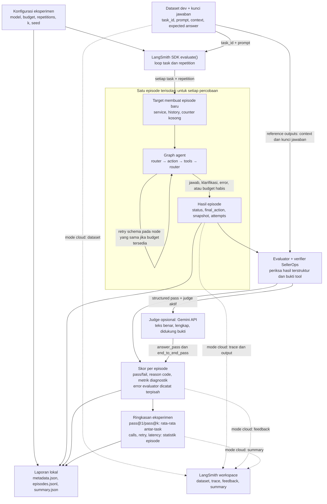

# SellerOps evaluation harness

Evaluation harness mengukur kemampuan agent menyelesaikan task SellerOps melalui
alur lengkap: menerima permintaan pengguna, menentukan tindakan, menggunakan
tool, dan menghasilkan jawaban terstruktur. Harness menjalankan sekumpulan task
dengan konfigurasi yang tercatat, memeriksa hasil setiap episode, lalu merangkum
tingkat keberhasilan dan perilaku agent selama eksekusi.

Hasil evaluasi digunakan untuk membandingkan model base dan SFT pada graph,
simulator, dataset, serta budget yang sama. pass@1 dan pass@k mengukur keberhasilan
task, sementara catatan model calls, retry, schema validity, dan latency membantu
menjelaskan penyebab keberhasilan atau kegagalannya.

## Cara kerja harness

Satu eksperimen dimulai dari task development yang dipilih dan konfigurasi model.
Setiap task dijalankan sebagai episode terpisah dengan service simulator, history,
dan counter baru. Agent menjalankan graph sampai menjawab, meminta klarifikasi,
atau berhenti karena error maupun batas eksekusi. Jika eksperimen menggunakan
beberapa repetition, harness mengulangi task dari kondisi awal yang sama.

Setelah episode berhenti, verifier memeriksa kandidat hasil terstruktur terhadap
context task, fakta simulator, dan bukti pemanggilan tool. Penilaian dilakukan di
luar loop agent. Status `completed` dari router saja belum berarti task berhasil;
episode harus memenuhi pemeriksaan hasil untuk memperoleh skor lulus.

Harness menyimpan hasil dan jejak setiap episode, kemudian mengagregasi skor
antar-pengulangan dan antar-task. Pemisahan ini memungkinkan satu kegagalan
ditelusuri dari skor ringkasan hingga output model dan observation tool-nya.



Panah penuh menunjukkan alur evaluasi dan laporan lokal; panah putus-putus
menunjukkan publikasi tambahan saat memakai `--cloud`. Retry tetap berada di
dalam episode dan berbagi budget agent. Repetition memulai episode baru melalui
target. Verifier berjalan setelah episode berakhir, sehingga skor evaluasi tidak
menjadi feedback retry bagi agent.

Input agent hanya berisi `task_id` dan `prompt`. Context penilaian dan kunci
jawaban berada di `reference_outputs`. Oracle trajectory dan expected answer
lama tidak dikirim ke model maupun diunggah sebagai acuan. Grader memakai fakta
simulator dan bukti tool.

## Kunci jawaban task development

Setiap task dev memiliki kunci jawaban yang disusun oleh **GPT-6 Astra** atas
permintaan user, dalam [dev_expected_answers.jsonl](../../../data/evaluation/dev_expected_answers.jsonl).
Referensi disimpan terpisah dan dihubungkan melalui `task_id`, sehingga file task
untuk training dan frozen test tidak perlu diubah.

- `expected_answer`: contoh jawaban untuk pengguna, mengikuti bahasa task.
- `expected_final_action`: hasil terstruktur yang sesuai kontrak SellerOps.
- `acceptance_notes`: fakta yang perlu dipenuhi dan variasi jawaban yang dapat diterima.
- `evidence_actions`: contoh pemanggilan tool untuk memvalidasi kunci terhadap simulator.

Saat dataset dimuat, loader memeriksa kelengkapan task, checksum sumber, schema,
dan kelulusan setiap hasil terstruktur melalui tool serta verifier pada episode
baru. Ini juga memeriksa koreksi label diskon negatif pada oracle lama: proposal
negatif tidak diperbolehkan. Manifest pendamping mencatat versi kunci, model
penyusun, tanggal, dan checksum task, fixture simulator, serta file jawaban.

LangSmith menerima teks jawaban, hasil terstruktur, dan acceptance notes sebagai
reference outputs. Ketiganya juga disertakan dalam `episodes.jsonl` untuk
membandingkan keluaran agent dengan kunci. Evidence actions tetap menjadi bahan
validasi lokal; agent yang dievaluasi tidak menerima kunci atau langkah contohnya.
Perubahan kunci menghasilkan fingerprint dan identitas dataset LangSmith baru.

`expected_answer` adalah referensi untuk inspeksi, bukan pemeriksaan exact-match
terhadap kalimat agent. Kelulusan dan pass@1/pass@k tetap memakai verifier hasil
terstruktur serta bukti tool, yang dapat menerima urutan tool dan hasil pencarian
alternatif yang valid. Judge opsional memakai referensi ini untuk menilai makna
teks jawaban router, sebagaimana dijelaskan di bawah.

## Peran LangSmith dan simulator

LangSmith SDK menggerakkan loop eksperimen: memanggil target untuk setiap task
dan repetition, menjalankan evaluator, serta mengumpulkan feedback. Logika
agent tetap berada di graph SellerOps; aturan kelulusan tetap ditentukan oleh
verifier SellerOps. Model, simulator, dan verifier berjalan di mesin yang
menjalankan Python.

Mode **offline** menggunakan runner SDK dan menyimpan laporan lokal. Mode
**cloud** juga mengirim dataset dev, trace, output, dan skor ke workspace
LangSmith agar episode dan eksperimen dapat diperiksa melalui dashboard.
Kedua mode menggunakan target, aturan penilaian, dan perhitungan metrik yang sama.

Trace mencatat eksekusi agent yang sudah terjadi. Snapshot/replay disediakan
oleh EpisodeService untuk memeriksa kembali tindakan dan observation simulator.
Verifier memakai replay untuk memvalidasi konsistensi history sebelum memeriksa
hasil task; snapshot yang tersimpan juga dapat diperiksa kembali secara terpisah.

Sebagai bahan perbandingan, `runner.py` menyertakan commented code loop Python
tanpa runner LangSmith. Contoh tersebut memakai target dan verifier yang sama,
sehingga peran penggerak eksperimen dapat dipelajari secara terpisah.

## Menjalankan evaluasi

Jalankan dari root project `projects/sellerops-agent/` menggunakan environment
Conda `llm-post-training`. Versi SDK dipin sebagai `langsmith==0.14.0` di
`environment.yml` lab.

```bash
conda run -n llm-post-training python scripts/evaluate_agent.py --offline --limit 1
```

`--offline` mengatur koneksi LangSmith. Loader model Hub masih bisa mengunduh
bobot yang belum ada di cache. Untuk mewajibkan bobot lokal:

```bash
HF_HUB_OFFLINE=1 TRANSFORMERS_OFFLINE=1 conda run -n llm-post-training python scripts/evaluate_agent.py --offline --limit 1
```

Untuk cloud, sediakan API key melalui environment terminal:

```bash
export LANGSMITH_API_KEY="<API key workspace kamu>"
# Sesuaikan LANGSMITH_ENDPOINT jika workspace memakai endpoint lain.
conda run -n llm-post-training python scripts/evaluate_agent.py --cloud --limit 1
```

Dataset cloud `sellerops-dev-<checksum>` mencakup 30 task dev beserta referensi
jawabannya. Checksum mencakup sumber task, kunci, dan provenance; `--limit` membatasi
task yang dijalankan. Dataset digunakan ulang setelah isinya diperiksa terhadap
file lokal. Isi yang berbeda ditolak, bukan ditimpa. Upload yang baru sebagian
selesai dapat dilanjutkan. Runner ini tidak membaca frozen test.

Bandingkan model action pada graph, router, dataset, dan budget yang sama:

```bash
conda run -n llm-post-training python scripts/evaluate_agent.py --cloud --action-model qwen-base
conda run -n llm-post-training python scripts/evaluate_agent.py --cloud --action-model sellerops-sft
```

Router default tetap `qwen-base`. SDK menampilkan tautan eksperimen cloud.
Evaluasi berurutan (`max_concurrency=0` pada SDK), karena model lokal memakai
cache adapter bersama. Ini belum pengujian concurrent users.

## Mode router

Evaluasi penuh 6 Oktober 2026 menghasilkan 0/30 karena router `qwen-base`
selalu menulis penjelasan pada keputusan `act`, sehingga model SFT tidak pernah
dipanggil. Ada dua perbaikan, keduanya bisa dipilih dari CLI:

- **Default (`--router-mode llm`)**: `act` dengan `text` tidak kosong kini
  diterima dan teksnya dibuang, karena teks itu memang tidak pernah dipakai.
  Jumlahnya tercatat sebagai `router_act_text_dropped` di `summary.json` dan
  `normalized: "act_text_dropped"` pada attempt terkait. `--strict-router`
  mengembalikan perilaku lama untuk mereproduksi run sebelumnya.
- **`--router-mode rule`**: router deterministik tanpa panggilan model. Setiap
  pesan user dan observasi tool diteruskan ke SFT; `final` SFT ditampilkan
  dengan `message`-nya dan `ask_user` dengan `question`-nya. Mode ini
  mengukur kemampuan model SFT tanpa dipengaruhi router. Sapaan atau obrolan
  bebas juga diteruskan ke SFT.

Bandingkan ketiganya pada 30 task dev:

```bash
python scripts/evaluate_agent.py --offline --router-mode rule
python scripts/evaluate_agent.py --offline --router-mode llm
python scripts/evaluate_agent.py --offline --router-mode llm --strict-router
```

## Judge teks jawaban (opsional)

Aktifkan `--judge gemini` untuk memeriksa jawaban akhir dengan Gemini API.
Default `--judge none` mempertahankan evaluasi terstruktur tanpa panggilan judge.
Integrasi menggunakan REST bawaan Python; tidak perlu memasang SDK tambahan.

```bash
export GEMINI_API_KEY="<API key dari Google AI Studio>"
conda run -n llm-post-training python scripts/evaluate_agent.py \
  --offline --limit 1 --judge gemini --judge-model gemini-3.8-flash
```

`--offline` hanya mematikan publikasi LangSmith. **Dengan `--judge gemini`, prompt
task, kunci jawaban, jawaban agent, dan bukti tool dikirim ke Google**, walaupun
laporan LangSmith tetap lokal. API key dibaca dari environment, dikirim melalui
header, dan tidak dimasukkan ke metadata/prompt. Tanpa key, runner berhenti sebelum
memuat model atau membuat eksperimen.

Gemini 3.8 Flash tercantum memiliki free tier pada
[halaman harga Gemini](https://ai.google.dev/gemini-api/docs/pricing), diperiksa
5 Oktober 2026. Kuota dan akses bergantung pada model/akun; kode tidak dapat
menjamin akun kamu menggunakan free tier. Periksa tier sebelum menjalankan batch.
Konten pada free tier dapat digunakan Google untuk meningkatkan produknya.
[Groq](https://console.groq.com/docs/rate-limits) juga menyediakan free plan,
tetapi adapter Groq belum disertakan. Model Gemini dapat diganti dengan
`--judge-model` sesuai model yang tersedia pada akun.

Judge berjalan setelah agent selesai, dan hanya dipanggil ketika verifier
terstruktur lolos. Ia melihat permintaan, reference answer, acceptance notes,
jawaban router sebenarnya, serta evidence tool. Rubrik meminta tiga boolean:

- `correct`: fakta, angka, dan kesimpulan benar.
- `complete`: informasi yang diminta pengguna terpenuhi.
- `grounded`: klaim didukung bukti, tanpa tindakan atau fakta yang dikarang.

Parafrasa dan alternatif yang valid diterima; kelulusan tidak bergantung pada
kemiripan kalimat. Ketiga kriteria harus true untuk `answer_pass=1`.
`end_to_end_pass=1` mensyaratkan **structured pass dan answer pass**. Jawaban judge
berisi alasan faktual singkat, tanpa meminta chain-of-thought. Field `judge` pada
output menyimpan verdict, versi rubrik/hash, model, model version bila tersedia,
usage token, dan latency penilaian. Judge tidak memberi feedback ke loop agent.

Skor `pass@1`/`pass@k` di tingkat utama summary tetap mengukur hasil terstruktur.
Bagian `end_to_end` memakai estimator yang sama untuk kelulusan gabungan; di
LangSmith namanya `end_to_end_pass@1` dan `end_to_end_pass@<k>`. Ini memungkinkan
hasil lama dibandingkan tanpa mengubah definisi metriknya secara diam-diam.

Kegagalan terstruktur langsung menghasilkan end-to-end fail tanpa memakai kuota
judge. Timeout, HTTP 429, output terpotong/invalid, atau error judge menghasilkan
skor unknown, bukan agent fail. Agregat end-to-end menjadi null jika ada episode
unknown; `judge_errors` dan CLI exit 2 menandainya. Hasil structured tetap tersedia.
Satu episode memakai paling banyak satu request judge, timeout 30 detik, tanpa
retry otomatis atau fallback ke model/provider lain. Summary tidak memanggil
judge ulang. Batas output adalah 4096 token; mulai dari `--limit 1` untuk memeriksa
akses, format jawaban, dan kuota akun.

Judge tetap dapat salah. Tinjau verdict pada contoh benar/salah yang diketahui
sebelum menggunakan skor untuk keputusan model; pengujian otomatis saat ini
memeriksa integrasi dan penanganan error, bukan akurasi penilaian Gemini.

## Retry dan pass@1 / pass@k

Retry berlangsung **di dalam satu episode**: JSON/schema invalid mengulang node
router/action yang sama, dengan feedback validasi privat. Default `--max-retries 2`
adalah budget bersama kedua model untuk seluruh episode; `0` menonaktifkannya.
`retry_count` menghitung percobaan ulang yang benar-benar dimulai. Initial attempt
tidak termasuk retry. Semua attempt, termasuk output invalid, memakai budget
`--max-model-calls`. Tool business error/policy rejection tetap menjadi observation;
exception model tidak otomatis diulang. Ini schema repair, belum replan.

Repetition adalah **episode baru** dengan service, history, dan counter kosong.
Runner memakai `num_repetitions` SDK. Contoh 3 episode per task, maksimal 2 retry
per episode, melaporkan pass@1 dan pass@3:

```bash
conda run -n llm-post-training python scripts/evaluate_agent.py --offline --limit 2 --repetitions 3 --pass-k 3 --max-retries 2 --temperature 0.7 --seed 42
```

Ganti `--offline` dengan `--cloud` untuk menerbitkan experiment dan summary
feedback yang sama. Default tetap satu repetition, k=1, dan greedy (`temperature=0`).
Greedy pada simulator tetap biasanya mengulang hasil yang sama; gunakan sampling
(`temperature>0`, top_p=1, top_k=0) untuk mengukur variasi percobaan. Seed generation
diturunkan dari base seed, task ID, trial index, lalu model-call index; disimpan
pada output/attempt. Implementasi seed mengikuti ModelAdapter CPU saat ini, dan
memulihkan RNG setelah episode. Reproducibility membutuhkan model/software sama.

Untuk setiap task dengan n episode dan c yang lolos verifier:

- **pass@1** = c/n: estimasi keberhasilan satu episode, termasuk retry internalnya.
- **pass@k** = `1 - C(n-c,k)/C(n,k)`: estimasi minimal satu keberhasilan dalam k episode.
  Harus `1 <= k <= n`. Ketika n=k, nilainya 1 jika ada episode yang berhasil.

Skor akhir adalah rata-rata antar-task dengan bobot sama. Misalnya n=4, c=2,
k=2 menghasilkan pass@1=0.5 dan pass@2=5/6. Ini bukan rasio sukses tool call.
Hasil disimpan sebagai `pass@1` dan `pass@<k>` di summary lokal serta experiment
summary LangSmith; k=1 cukup satu key. Trial hilang atau error evaluator membuat
kedua skor null, sehingga tidak memperbaiki skor dengan membuang trial bermasalah.
Metrik diagnostik calls/schema/latency melengkapi kedua metrik keberhasilan tersebut.

## Hasil dan batas penilaian

Setiap run memiliki folder unik di `results/evaluation/`:

- `metadata.json`: konfigurasi model/source, checksum data/kunci, provenance kunci, dan task terpilih.
- `episodes.jsonl`: reference outputs, snapshot, history, attempts, skor, reason code, dan error
  setiap episode. Record ditulis segera setelah evaluasi task selesai.
- `summary.json`: pass@1/pass@k, jumlah episode dan kelulusan, error evaluator,
  rata-rata calls/retry, latency p50/p95, schema validity, serta ringkasan per
  task family.

`structured_outcome_pass` menilai hasil terstruktur. Tanpa judge, teks router
belum dinilai dan `answer_groundedness` tetap `not_evaluated`. Dengan judge aktif,
verdict teks dan gabungan tersedia untuk episode yang lolos verifier. Router yang menjawab tanpa
kandidat `final`/`ask_user` mendapat `missing_structured_outcome`. Kandidat lama
dibersihkan saat action model memanggil tool lagi. Integrasi ini mengukur
perilaku graph yang ada, termasuk kekurangannya.

JSON/schema yang tetap invalid setelah retry, exception model/tool, dan budget
habis menjadi kegagalan episode; task berikutnya tetap berjalan.
Error grader menjadi `evaluation_error`;
aggregate pass rate tidak diterbitkan jika ada task yang gagal dinilai. CLI exit 2
menandai masalah harness; skor agent rendah sendiri tidak membuat CLI gagal.

Percobaan gagal parsing ikut `model_calls` dan denominator schema validity.
`committed_model_calls` ikut menghitung attempt invalid dan gagal generation.
`retry_count` tersedia di output, feedback per episode, dan rata-rata summary.
Schema validity router dan action dipisahkan. Dashboard menampilkan rasio per
episode; summary lokal menggabungkan semua output yang diperiksa.
`blocked_policy_attempt` mencatat percobaan diskon yang diblokir tool.

Token dihitung dari tokenizer/generation sebenarnya, termasuk bila parsing
kemudian gagal. Cloud memiliki child trace LLM dengan source dan revision jika
tersedia. Revision checkpoint lokal bisa null; source folder tetap dicatat.
Tidak ada estimasi biaya GPU lokal atau time-to-first-token. Latency episode
mencakup pemuatan model pada panggilan pertama, dan berakhir sebelum grading
serta pengunggahan hasil episode; tracing aktif dapat menambah overhead.
Seed metadata dataset adalah seed pembentukan task; seed generation dicatat
terpisah. Simulator memakai fixture default yang tetap.

Mode offline menonaktifkan callback cloud graph secara eksplisit untuk versi
LangChain terpasang; attempts/history tersimpan di output episode. Mode ini
tetap memakai loop SDK. Komentar di `runner.py` menunjukkan loop Python biasa.

Replan, hard wall-clock timeout untuk agent, dan kelanjutan percakapan otomatis
belum ditambahkan. Budget panggilan/token/tool tetap
berlaku. Snapshot/replay tetap milik EpisodeService yang digunakan bersama runtime.

## Pengujian

```bash
conda run -n llm-post-training pytest -q tests/evaluation/test_langsmith.py
```

Tes menggunakan SDK, graph, tools, dan grader asli dengan generation terprogram;
akses jaringan diblokir. Sinkronisasi cloud diuji melalui client pengganti.
Pengujian workspace nyata memerlukan API key.

Referensi: [evaluation target](https://docs.langchain.com/langsmith/define-target-function),
[custom evaluator SDK](https://docs.langchain.com/langsmith/code-evaluator-sdk),
[tracing model custom](https://docs.langchain.com/langsmith/log-llm-trace),
[repetitions](https://docs.langchain.com/langsmith/repetition),
[estimator pass@k HumanEval](https://github.com/openai/human-eval/blob/master/human_eval/evaluation.py).
